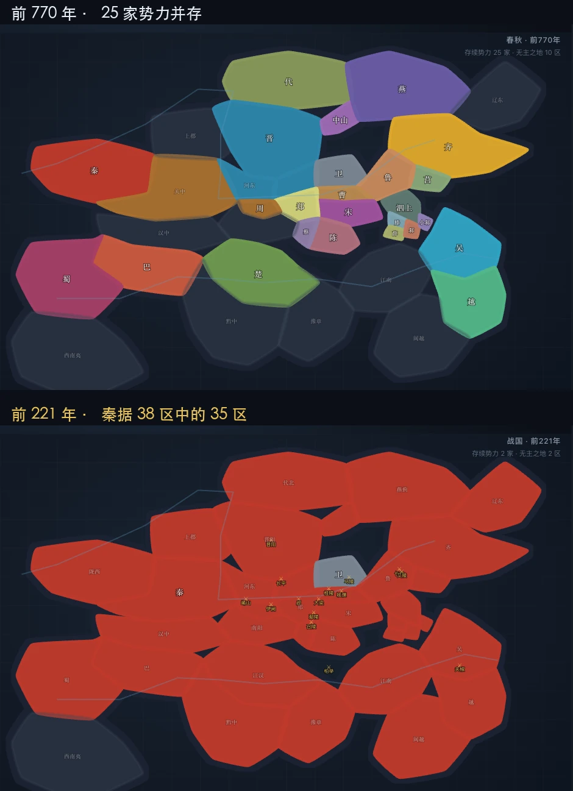

<p align="center">
  <picture>
    <source media="(prefers-color-scheme: dark)" srcset="../assets/readme/logo-dark.svg" />
    
  </picture>
</p>

# 时空图集 Chrono Atlas

**把历史的疆域、人口与事件做成可交互的时间轴动画。每个演示都附一份可读、可校验、可贡献的数据。**

<p align="center">
  <a href="https://github.com/phaethix/chrono-atlas"></a>
  <a href="https://github.com/phaethix/chrono-atlas/actions/workflows/ci.yml"></a>
  <a href="../LICENSE"></a>
  <a href="../README.md"></a>
</p>

中国历史的可复现数据与动画，按 24 卷规划。前两个演示是史前与春秋战国：边界来自坐标列表，人物与关系在全库只存一份，哪一卷提到都指向同一条记录。

这套图集正从「只有疆域」扩到二十四卷的跨度：谁是谁的儿子、谁继了谁的位、谁师承于谁，以及这些说法里哪些出自发掘、哪些出自后世的追述。方案见 [design/0003](design/0003-full-history-architecture.md)。

<p align="center">
  
</p>

左右两图是同一个页面的两个年份。它们之间没有一处是手绘的：每一帧都由坐标列表与年表重新生成，所以右图只是数据显示的左图的去向。

[在线浏览](https://phaethix.github.io/chrono-atlas/) · [第一个演示](https://phaethix.github.io/chrono-atlas/demos/chunqiu-zhanguo/index.html) · [English README](../README.md)

## 这是什么

历史地图通常是一张画好的图片：边界看得出，但看不出某条线为什么在那儿，也没法改。这里的每个区域边界是一组经纬度顶点，每次归属变化是年表里的一条记录。改坐标就能改边界，改年份就能改结论，改完刷新即可见效。

所以每一处版图变化都能追溯到年份与史料，也能被脚本校验。数据错了，交互做得再精致也只是把错误放大，因此每个演示都配了完整性检查。

## 演示

| 演示                                               | 区间              | 内容                                            |
| -------------------------------------------------- | ----------------- | ----------------------------------------------- |
| [春秋战国 · 疆域与兼并](../demos/chunqiu-zhanguo/) | 前 770 — 前 221   | 38 个历史区域，29 个势力，68 条事件，15 场战役  |
| [祖先 · 从蛙到龙](../demos/zuxian/)                | 前 7000 — 前 1900 | 39 个区域，17 支考古学文化，46 条事件，9 处遗址 |
| [五帝世系 · 血缘与继位](../demos/shixi/)           | 上古              | 20 个人物，35 条关系边                          |

想加新题材，见 [adding-a-demo.md](adding-a-demo.md)。

## 快速开始

不需要安装任何东西。克隆后直接打开：

```bash
git clone https://github.com/phaethix/chrono-atlas.git
cd chrono-atlas
open index.html
```

双击 `index.html` 也可以。没有构建步骤，没有运行时依赖，不需要 Node。

想跑校验则需要 Node 18 以上：

```bash
node scripts/check.mjs   # 数据完整性、站内链接、演示登记
npx prettier --check .   # 格式
```

两条都通过再提 PR。背后的约定见 [AGENTS.md](../AGENTS.md)。

## 目录结构

```
chrono-atlas/
├── index.html              画廊首页
├── catalog/manifest.js     24 卷：卷次、书名、分期、状态、章目
├── corpus/                 跨卷共享的人物、群体、地点、文献与关系
│   ├── schema.js           实体与关系的词表
│   ├── people/<era>.js     人物分片，按时代切，不按卷切
│   └── relations/<era>.js  血缘、继位、师承、敌对
├── demos/                  每册书一个视图目录
│   ├── chunqiu-zhanguo/
│   │   ├── index.html      页面骨架
│   │   ├── data.js         本卷数据
│   │   ├── app.js          渲染与交互
│   │   ├── style.css       本演示样式
│   │   └── README.md       史料依据与已知简化
│   └── zuxian/
│       └── …               同样五个文件
├── assets/site.css         站点级共享样式
├── docs/                   数据格式、架构决策、中文 README
└── scripts/check.mjs       零依赖自检
```

数据与渲染严格分开：`data.js` 里没有一行 DOM 操作，`app.js` 里没有一个坐标常量。改数据只碰前者，改画法只碰后者。

## 技术取向

纯静态、零构建、零依赖。这样做不是排斥工具链，而是希望十年后这些页面仍然能打开。

第二个演示把这个选择的代价摆到了明处：画法几乎逐行重复，这份重复被接受了。真正没能通用的不是画法，而是用词——文化取代文化，不是国家灭了国家；传说也不等于发掘。这些差异被放进数据（`META.terms`、`shift` 事件、`src` 标签），而不是抽一层引擎。理由见 [design/0002](design/0002-second-demo-and-data-semantics.md)。

## 贡献

欢迎贡献数据勘误、新的演示、或者渲染改进。开始之前请读 [CONTRIBUTING.md](../CONTRIBUTING.md)。

其中最重要的一条：**史实类改动请附出处**。年份异说、边界依据、地名沿革，都请在 PR 里说明取哪一说、为什么。

## 协议

[MIT](../LICENSE)。代码与数据同一协议，用起来不必分两套规则。

史料原文与第三方历史地图的版权归属原权利人，本仓库只使用其记载的事实与公开的史实结论。
